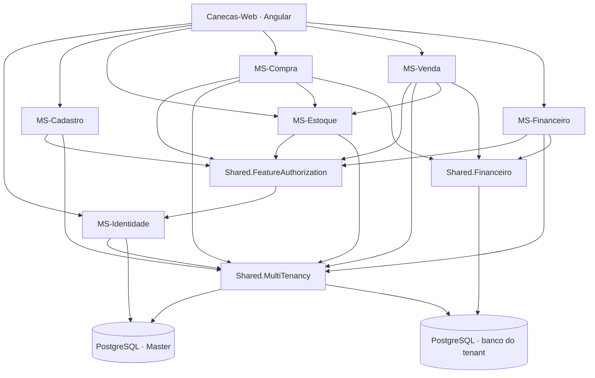
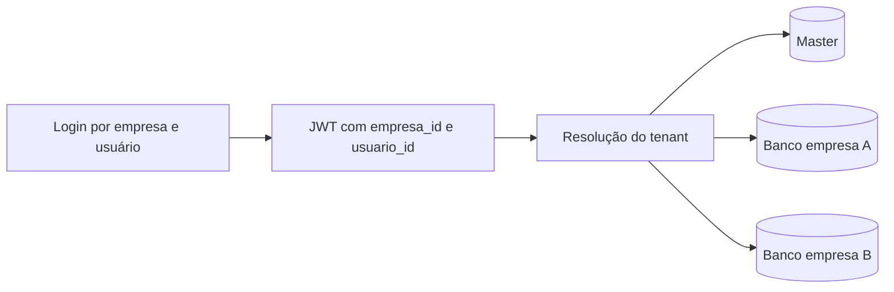
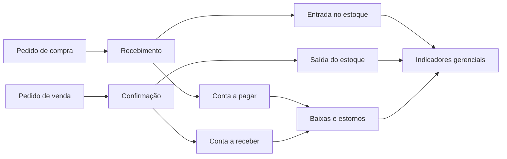

<div align="center">

# ERP Canecas

**Gestão empresarial integrada · Integrated enterprise management**

ERP multi-tenant para operações comerciais, estoque, financeiro e análise gerencial.

Multi-tenant ERP for commercial operations, inventory, finance and business intelligence.


[Português](#português) · [English](#english) · [Contribuidores](../../graphs/contributors)

</div>

---

## Português

### Visão geral

O ERP Canecas é um projeto acadêmico de gestão empresarial voltado ao comércio de canecas. A solução integra cadastros, compras, vendas, estoque e financeiro em uma aplicação web com indicadores de BI. Cada empresa possui seus próprios dados, usuários, permissões e identidade visual.

### Funcionalidades

| Módulo | Recursos |
| --- | --- |
| Identidade | Login, JWT, usuários, permissões hierárquicas por feature e tema por empresa |
| Cadastros | Clientes, fornecedores, produtos, categorias e unidades de medida |
| Estoque | Saldos, estoque mínimo, custo médio ponderado, ajustes e estornos |
| Compras | Pedidos, itens, recebimento integral, entrada no estoque e geração de contas a pagar |
| Vendas | Preço unitário livre, confirmação, baixa de estoque, custo histórico e cancelamento |
| Financeiro | Contas a pagar e receber, vencimentos, baixas totais ou parciais e estornos |
| BI | Faturamento, lucro e margem bruta, compras, saldos financeiros, comparações por período, gráficos e ranking de produtos |

### Arquitetura

A solução utiliza seis APIs ASP.NET Core e uma aplicação Angular. Os serviços são separados por domínio, com bibliotecas compartilhadas para resolução do tenant, autorização e integração financeira. Os domínios operacionais compartilham o banco da empresa, em schemas distintos, permitindo transações locais entre compras, vendas, estoque e financeiro.



As ligações de Compras e Vendas com Estoque representam reutilização de código e persistência, não chamadas HTTP entre os serviços para movimentar saldo.

### Multi-tenancy e segurança

O padrão **Database per Tenant** separa os dados de cada empresa em bancos PostgreSQL próprios. O banco Master mantém o cadastro central das empresas e a identificação de seus bancos, além da configuração visual.



- Senhas armazenadas como hash com ASP.NET Core PasswordHasher.
- JWT assinado, com validação de assinatura, emissor, audiência e expiração.
- Autorização por funcionalidades no backend e guards no frontend.
- Resolução da conexão da empresa no servidor a partir da identidade autenticada.
- Credenciais fora do código versionado.

### Integração operacional



O recebimento de uma compra de valor positivo gera uma obrigação financeira. A confirmação da venda registra o custo médio vigente e gera um título a receber. A movimentação de estoque e a geração do título ocorrem na mesma transação PostgreSQL da operação comercial. O cancelamento de uma venda confirmada estorna o estoque e cancela o título, desde que não existam baixas financeiras ativas.

O Dashboard distingue faturamento de recebimentos efetivos. O lucro bruto considera o custo registrado na venda, não o total de compras do período.

### Serviços e portas locais

| Componente | Porta | Responsabilidade |
| --- | ---: | --- |
| Canecas-Web | 4200 | Interface web e BI |
| MS-Identidade | 5127 | Autenticação, usuários e permissões |
| MS-Cadastro | 5259 | Cadastros empresariais |
| MS-Estoque | 5260 | Saldos e movimentações |
| MS-Compra | 5261 | Pedidos de compra |
| MS-Venda | 5262 | Pedidos de venda |
| MS-Financeiro | 5263 | Títulos e baixas |

### Persistência

| Schema | Principais tabelas |
| --- | --- |
| Master / public | empresas, empresas_temas |
| identidade | usuarios, features, usuarios_features |
| cadastro | clientes, fornecedores, produtos, categorias, unidades_medida |
| estoque | saldos, movimentacoes |
| compras | pedidos, pedidos_itens |
| vendas | pedidos, pedidos_itens |
| financeiro | titulos, baixas |

### Stack e organização

**Backend:** C#, .NET 10, ASP.NET Core Web API, Entity Framework Core, Npgsql, JWT Bearer e OpenAPI.

**Frontend:** Angular 21, TypeScript 5.9, RxJS, SCSS e Apache ECharts.

**Banco:** PostgreSQL 16. **Versionamento:** Git e GitHub.

```text
ERP_Canecas/
├── Canecas-Web/
├── MS-Identidade/
├── MS-Cadastro/
├── MS-Estoque/
├── MS-Compra/
├── MS-Venda/
├── MS-Financeiro/
├── Shared/
│   ├── MultiTenancy/
│   ├── FeatureAuthorization/
│   └── Financeiro/
└── ERP_Canecas.sln
```

### Executando localmente

Pré-requisitos: .NET 10 SDK, PostgreSQL, Git, Node.js compatível com Angular 21 (por exemplo, Node.js 22.12 ou superior na linha 22) e npm.

```bash
git clone https://github.com/spedrosantos/ERP_Canecas.git
cd ERP_Canecas
dotnet restore ERP_Canecas.sln
dotnet build ERP_Canecas.sln
```

**1. Banco de dados**

Prepare o banco Master e um banco por empresa, com os schemas, constraints, índices, roles, empresas, usuários iniciais e permissões necessários. Os scripts SQL são mantidos na documentação do projeto; os comandos abaixo não criam os bancos automaticamente. O exemplo utiliza a porta local 5433.

**2. Credenciais**

Configure User Secrets em cada serviço. Alguns projetos compartilham o mesmo armazenamento de secrets; o procedimento abaixo também cobre aqueles com armazenamento próprio. Substitua os valores de exemplo por credenciais locais válidas e utilize a mesma chave JWT forte em todos os serviços.

```bash
for servico in MS-Identidade MS-Cadastro MS-Estoque MS-Compra MS-Venda MS-Financeiro; do
  dotnet user-secrets set "ConnectionStrings:MasterConnection" "Host=localhost;Port=5433;Database=canecas_erp_master;Username=USUARIO_MASTER;Password=SENHA_MASTER" --project "$servico"
  dotnet user-secrets set "ConnectionStrings:canecas_erp_boracup" "Host=localhost;Port=5433;Database=canecas_erp_boracup;Username=USUARIO_TENANT;Password=SENHA_TENANT" --project "$servico"
  dotnet user-secrets set "Jwt:Key" "SUBSTITUA_POR_CHAVE_FORTE_COMPARTILHADA" --project "$servico"
done
```

O nome da connection string do tenant deve corresponder ao nome do banco cadastrado no Master. User Secrets é destinado ao desenvolvimento; em produção utilize gerenciamento seguro de segredos.

**3. APIs**

Execute cada comando em um terminal separado, a partir da raiz. Inicie a Identidade primeiro.

```bash
dotnet run --project MS-Identidade
dotnet run --project MS-Cadastro
dotnet run --project MS-Estoque
dotnet run --project MS-Compra
dotnet run --project MS-Venda
dotnet run --project MS-Financeiro
```

As APIs disponibilizam OpenAPI no ambiente de desenvolvimento. A interface utiliza o proxy local do Angular.

**4. Frontend**

```bash
cd Canecas-Web
npm ci
npm start
```

Acesse [http://localhost:4200](http://localhost:4200) e utilize um usuário previamente provisionado para a empresa.

Para verificar a compilação e executar os testes frontend disponíveis:

```bash
npm run build
npm test -- --watch=false
```

### Estado do projeto

Projeto acadêmico com os módulos principais implementados. A validação final de integração, concorrência, isolamento e provisionamento de novos ambientes permanece importante antes de qualquer uso em produção. Compras e vendas anteriores à integração financeira podem exigir regularização de títulos.

---

## English

### Overview

ERP Canecas is an academic enterprise resource planning project for a mug retail business. It integrates commercial operations, inventory, finance and business intelligence in a multi-tenant web application with company-specific branding.

### Features

| Module | Capabilities |
| --- | --- |
| Identity | JWT login, user management and hierarchical feature permissions |
| Registration | Customers, suppliers, products, categories and units of measure |
| Inventory | Stock balances, minimum stock, weighted average cost, adjustments and reversals |
| Purchasing | Purchase orders, full receipt, stock entries and accounts payable |
| Sales | Flexible unit prices, confirmation, stock deduction, historical cost and cancellation |
| Finance | Accounts payable and receivable, partial or full settlements and reversals |
| BI | Revenue, gross profit, gross margin, purchases, outstanding balances, period comparisons and charts |

### Architecture and data

The system consists of six ASP.NET Core APIs and an Angular application. A master PostgreSQL database identifies each company's dedicated tenant database. Operational domains use separate schemas within that tenant database, enabling local transactions across commercial operations, inventory and finance.

Shared libraries provide tenant connection resolution, feature-based authorization and transactional financial integration. Purchase and sales services reuse inventory persistence and rules. Positive-value purchase receipts create payable titles, and confirmed sales create receivable titles while capturing the inventory cost. Financial settlements are tracked separately from sales revenue.

See the [architecture diagrams](#arquitetura), [database layout](#persistência) and [service ports](#serviços-e-portas-locais) above.

### Technology stack

C# · .NET 10 · ASP.NET Core · Entity Framework Core · Npgsql · PostgreSQL · JWT · Angular 21 · TypeScript · RxJS · SCSS · Apache ECharts.

### Local setup

1. Install the .NET 10 SDK, PostgreSQL, Git, a Node.js version compatible with Angular 21 and npm.
2. Clone the repository and restore/build the solution.
3. Provision the master and tenant databases using the project SQL documentation, including initial companies, users and permissions.
4. Configure database connection strings and a consistent JWT signing key through User Secrets for every service. Never commit credentials.
5. Start the six APIs in separate terminals, starting with Identity.
6. In `Canecas-Web`, run `npm ci` and `npm start`, then open [http://localhost:4200](http://localhost:4200).

Full commands and configuration examples are in [Executando localmente](#executando-localmente).

### Project status

Academic project with the core modules implemented. Final integration, concurrency and tenant-isolation validation is required before production use.

---

<div align="center">

**ERP Canecas** · Projeto acadêmico / Academic project

[Pedro Santos](https://github.com/spedrosantos) · [Equipe e contribuidores / Team and contributors](../../graphs/contributors)

</div>
