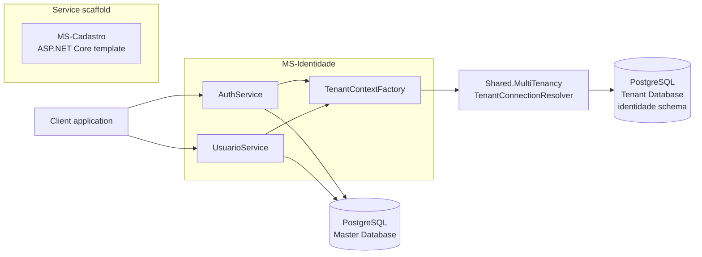

<div align="center">

<h1>ERP Canecas</h1>

<p><strong>Enterprise Resource Planning Platform</strong></p>

<p>Plataforma ERP desenvolvida com C# e .NET, organizada em serviços independentes e com isolamento de dados por empresa.</p>

<p>
  
  
  
  
  
</p>

<p>
  <a href="#português">Português</a>
  &nbsp;|&nbsp;
  <a href="#english">English</a>
</p>

</div>

---

## Português

### Visão geral

O **ERP Canecas** é uma plataforma de gestão empresarial em desenvolvimento, construída com C# e .NET. A solução está organizada em serviços independentes e utiliza PostgreSQL para persistência de dados.

A arquitetura adota a estratégia **Database per Tenant**: as informações centrais das empresas ficam em um banco Master, enquanto os dados operacionais e de identidade de cada empresa ficam em um banco próprio. A conexão do tenant é resolvida dinamicamente a partir do cadastro da empresa.

Neste estágio, o principal serviço funcional é o **MS-Identidade**, responsável pelo login, emissão de tokens JWT, cadastro de usuários e autorização baseada em funcionalidades. O **MS-Cadastro** está no estágio inicial de scaffold do ASP.NET Core e ainda não contém cadastros empresariais implementados.

### Arquitetura

O diagrama representa o fluxo atualmente implementado. O MS-Cadastro aparece separado porque ainda não possui integração funcional com os demais componentes.


### Componentes

#### MS-Identidade

Serviço responsável pela autenticação, gerenciamento de usuários e autorização de acesso.

**Autenticação e tokens**

- Login por empresa, usuário e senha.
- Verificação do status ativo da empresa e do usuário.
- Verificação de senha com `PasswordHasher<Usuario>` do ASP.NET Core.
- Emissão de JWT assinado com HMAC-SHA256.
- Claims de identificação do usuário (`usuario_id`), da empresa (`empresa_id`) e nome (`nome`).
- Validação de assinatura, emissor, audiência e validade do token.
- Identificador único do token por meio da claim `jti`.

**Cadastro de usuários**

- Cadastro vinculado à empresa identificada no token.
- Validação da empresa antes de acessar o banco do tenant.
- Hash da senha antes da persistência.
- Retorno dos dados do usuário sem expor o hash da senha.
- Proteção do endpoint por autenticação e pela policy `USUARIO_CADASTRAR`.

#### Autorização baseada em funcionalidades

O serviço utiliza autorização baseada em funcionalidades (*Feature-Based Authorization*) com Policies do ASP.NET Core e um handler personalizado.

As funcionalidades são representadas pela entidade `Feature`, que possui código, nome, status e referência opcional à funcionalidade pai. A associação entre usuários e funcionalidades é armazenada em `UsuarioFeature`.

A implementação atual verifica se o usuário possui a funcionalidade solicitada ativa e percorre sua cadeia de funcionalidades pai. A autorização depende de a cadeia necessária estar presente entre as funcionalidades ativas atribuídas ao usuário.

Policies configuradas no serviço:

| Código | Finalidade |
|---|---|
| `USUARIO` | Funcionalidades relacionadas à gestão de usuários |
| `USUARIO_CADASTRAR` | Autorizar o cadastro de usuários |
| `USUARIO_PERMISSOES` | Funcionalidades relacionadas às permissões de usuários |

O `FeatureAuthorizationHandler` obtém os identificadores do usuário e da empresa a partir das claims do JWT e delega a verificação ao `PermissaoService`.

#### MS-Cadastro

Projeto ASP.NET Core criado como parte da solução. Atualmente contém a estrutura inicial do serviço e o endpoint de exemplo `WeatherForecast`, gerado pelo template padrão.

As operações de cadastro empresarial ainda não foram implementadas.

#### Shared.MultiTenancy

Biblioteca compartilhada que concentra a resolução de conexões dos bancos dos tenants.

O componente `TenantConnectionResolver` recebe o nome do banco associado à empresa e procura a connection string correspondente na configuração da aplicação. O `TenantContextFactory`, no MS-Identidade, utiliza essa resolução para criar um `TenantDbContext` conectado ao banco selecionado.

### Persistência e isolamento de dados

A solução utiliza PostgreSQL com bancos separados por empresa.

| Banco / contexto | Responsabilidade |
|---|---|
| Master Database | Armazenar o cadastro central das empresas e o nome do banco associado a cada uma |
| Tenant Database | Armazenar os dados de identidade e as funcionalidades da empresa |

No banco Master, o `MasterDbContext` mapeia a tabela `empresas`, incluindo razão social, nome fantasia, CNPJ, nome do banco e status. O CNPJ e o nome do banco possuem índices únicos.

No banco de cada tenant, o `TenantDbContext` mapeia as tabelas abaixo no schema `identidade`:

| Tabela | Finalidade |
|---|---|
| `usuarios` | Dados e hash de senha dos usuários |
| `features` | Catálogo de funcionalidades e relação hierárquica |
| `usuarios_features` | Associação entre usuários e funcionalidades |

O acesso ao Master é feito por `MasterDbContext`. O acesso ao banco da empresa é criado sob demanda por `TenantContextFactory`, utilizando o `TenantConnectionResolver`.

### API disponível

| Método | Rota | Acesso | Descrição |
|---|---|---|---|
| POST | `/api/auth/login` | Público | Valida as credenciais e retorna um JWT |
| POST | `/api/usuarios` | JWT + policy `USUARIO_CADASTRAR` | Cadastra um usuário na empresa do token |

**Dados esperados no login:**

| Campo | Tipo | Descrição |
|---|---|---|
| `EmpresaId` | `long` | Identificador da empresa no banco Master |
| `UsuarioId` | `long` | Identificador do usuário no banco do tenant |
| `Senha` | `string` | Senha informada pelo usuário |

**Dados esperados no cadastro de usuário:**

| Campo | Tipo | Descrição |
|---|---|---|
| `Nome` | `string` | Nome do usuário |
| `Senha` | `string` | Senha inicial, armazenada como hash |

O login retorna identificadores do usuário e da empresa, nome, token e data de expiração. O cadastro retorna identificador, nome, status e data de criação.

### Tecnologias

| Tecnologia | Utilização |
|---|---|
| C# | Linguagem principal |
| .NET 10 | Plataforma de desenvolvimento |
| ASP.NET Core Web API | Construção dos serviços HTTP |
| PostgreSQL | Banco de dados relacional |
| Entity Framework Core | Mapeamento objeto-relacional |
| Npgsql | Provedor de acesso ao PostgreSQL |
| JWT Bearer | Autenticação por token |
| ASP.NET Core PasswordHasher | Hash e verificação de senhas |
| Git e GitHub | Versionamento e hospedagem do código |

### Estrutura do repositório

```text
ERP_Canecas/
├── MS-Identidade/
│   ├── Authorization/
│   │   ├── FeatureAuthorizationHandler.cs
│   │   └── FeatureRequirement.cs
│   ├── Controllers/
│   │   ├── AuthController.cs
│   │   └── UsuariosController.cs
│   ├── DTOs/
│   │   ├── Auth/
│   │   └── Usuarios/
│   ├── Data/
│   │   ├── Interfaces/
│   │   ├── MasterDbContext.cs
│   │   ├── TenantContextFactory.cs
│   │   └── TenantDbContext.cs
│   ├── Entities/
│   ├── Repositories/
│   │   └── Interfaces/
│   ├── Services/
│   │   └── Interfaces/
│   ├── Program.cs
│   └── MS-Identidade.csproj
│
├── MS-Cadastro/
│   ├── Controllers/
│   │   └── WeatherForecastController.cs
│   ├── Program.cs
│   └── MS-Cadastro.csproj
│
├── Shared/
│   └── MultiTenancy/
│       ├── Interfaces/
│       ├── Services/
│       └── MultiTenancy.csproj
│
└── ERP_Canecas.sln
```

### Configuração do ambiente

#### Pré-requisitos

- .NET 10 SDK.
- PostgreSQL.
- Git.

#### Clonar o repositório

```bash
git clone https://github.com/spedrosantos/ERP_Canecas.git
cd ERP_Canecas
```

#### Configurar as credenciais

O projeto MS-Identidade possui suporte a User Secrets. Configure as connection strings e a chave JWT localmente, sem incluí-las nos arquivos versionados.

Exemplo para o ambiente local utilizado no desenvolvimento, com PostgreSQL na porta `5433`:

```bash
dotnet user-secrets set "ConnectionStrings:MasterConnection" "Host=localhost;Port=5433;Database=canecas_erp_master;Username=SEU_USUARIO;Password=SUA_SENHA" --project MS-Identidade

dotnet user-secrets set "ConnectionStrings:canecas_erp_boracup" "Host=localhost;Port=5433;Database=canecas_erp_boracup;Username=SEU_USUARIO;Password=SUA_SENHA" --project MS-Identidade

dotnet user-secrets set "Jwt:Key" "SUA_CHAVE_JWT_FORTE" --project MS-Identidade
```

A chave de configuração `ConnectionStrings:canecas_erp_boracup` deve corresponder ao valor armazenado em `NomeBanco` no cadastro da empresa. Para cada nova empresa, configure uma connection string cujo nome corresponda ao respectivo banco.

O emissor, a audiência e o tempo de expiração do JWT possuem valores padrão em `appsettings.json`. A chave de assinatura deve ser fornecida fora do repositório.

#### Preparar os bancos de dados

O repositório contém os mapeamentos do Entity Framework Core, mas não inclui migrations nem scripts SQL para criação da estrutura. Antes de executar o serviço, os bancos e as tabelas mapeadas pelos contextos devem estar preparados conforme a estrutura definida para o projeto.

#### Restaurar e executar

Na raiz da solução:

```bash
dotnet restore ERP_Canecas.sln
dotnet run --project MS-Identidade/MS-Identidade.csproj
```

O documento OpenAPI é disponibilizado pelo MS-Identidade em ambiente de desenvolvimento.

### Estado atual

O MS-Identidade possui implementação de login, emissão e validação de JWT, cadastro de usuários e autorização baseada em funcionalidades. A resolução dinâmica de conexões por empresa está implementada na biblioteca compartilhada e é utilizada pelo serviço de identidade.

O MS-Cadastro permanece no estágio inicial do template ASP.NET Core. A solução continua em desenvolvimento e os componentes ainda não implementados não são apresentados como funcionalidades disponíveis.

---

## English

### Overview

**ERP Canecas** is an Enterprise Resource Planning platform under development, built with C# and .NET. The solution is organized into independent services and uses PostgreSQL for data persistence.

The architecture follows a **Database per Tenant** strategy: central company information is stored in a Master database, while each company's operational and identity data is stored in its own database. Tenant connections are resolved dynamically using the company's registration data.

At this stage, the main functional service is **MS-Identidade**, responsible for login, JWT issuance, user registration, and feature-based authorization. **MS-Cadastro** is currently at the initial ASP.NET Core scaffold stage and does not yet contain implemented business registration features.

### Architecture

The diagram represents the currently implemented flow. MS-Cadastro is shown separately because it does not yet have functional integrations with the other components.



### Components

#### MS-Identidade

Service responsible for authentication, user management, and access authorization.

**Authentication and tokens**

- Login using company ID, user ID, and password.
- Validation of the company's and user's active status.
- Password verification using ASP.NET Core's `PasswordHasher<Usuario>`.
- HMAC-SHA256 signed JWT issuance.
- User (`usuario_id`), company (`empresa_id`), and name (`nome`) claims.
- Token validation for signature, issuer, audience, and lifetime.
- Unique token identifier through the `jti` claim.

**User registration**

- User registration associated with the company identified by the token.
- Company validation before accessing the tenant database.
- Password hashing before persistence.
- Response containing user data without exposing the password hash.
- Endpoint protected by authentication and the `USUARIO_CADASTRAR` policy.

#### Feature-based authorization

The service uses *Feature-Based Authorization* through ASP.NET Core Policies and a custom authorization handler.

Features are represented by the `Feature` entity, which contains a code, name, active status, and optional parent-feature reference. The relationship between users and features is stored in `UsuarioFeature`.

The current implementation checks whether the requested feature is actively assigned to the user and traverses its parent-feature chain. Authorization requires the necessary chain to be present among the active features assigned to that user.

Policies configured in the service:

| Code | Purpose |
|---|---|
| `USUARIO` | User management features |
| `USUARIO_CADASTRAR` | Authorize user registration |
| `USUARIO_PERMISSOES` | User permission management features |

The `FeatureAuthorizationHandler` obtains the user and company identifiers from JWT claims and delegates the permission check to `PermissaoService`.

#### MS-Cadastro

ASP.NET Core project included in the solution. It currently contains the initial service structure and the `WeatherForecast` sample endpoint generated by the default template.

Business registration operations have not yet been implemented.

#### Shared.MultiTenancy

Shared library that centralizes tenant database connection resolution.

The `TenantConnectionResolver` receives the database name associated with a company and retrieves the matching connection string from application configuration. The `TenantContextFactory`, in MS-Identidade, uses this resolver to create a `TenantDbContext` connected to the selected database.

### Data persistence and isolation

The solution uses PostgreSQL with separate databases for each company.

| Database / context | Responsibility |
|---|---|
| Master Database | Stores the central company registry and the database name associated with each company |
| Tenant Database | Stores each company's identity data and features |

In the Master database, `MasterDbContext` maps the `empresas` table, including legal name, trade name, CNPJ, database name, and status. CNPJ and database name have unique indexes.

In each tenant database, `TenantDbContext` maps the following tables under the `identidade` schema:

| Table | Purpose |
|---|---|
| `usuarios` | User data and password hashes |
| `features` | Feature catalog and hierarchical relationships |
| `usuarios_features` | Relationship between users and features |

Master access is provided through `MasterDbContext`. Access to a company's database is created on demand by `TenantContextFactory`, using `TenantConnectionResolver`.

### Available API

| Method | Route | Access | Description |
|---|---|---|---|
| POST | `/api/auth/login` | Public | Validates credentials and returns a JWT |
| POST | `/api/usuarios` | JWT + `USUARIO_CADASTRAR` policy | Registers a user in the company identified by the token |

**Login request fields:**

| Field | Type | Description |
|---|---|---|
| `EmpresaId` | `long` | Company identifier in the Master database |
| `UsuarioId` | `long` | User identifier in the tenant database |
| `Senha` | `string` | User password |

**User registration request fields:**

| Field | Type | Description |
|---|---|---|
| `Nome` | `string` | User name |
| `Senha` | `string` | Initial password, stored as a hash |

The login response includes the user and company identifiers, name, token, and expiration date. The registration response includes the user identifier, name, status, and creation date.

### Technology stack

| Technology | Purpose |
|---|---|
| C# | Main programming language |
| .NET 10 | Development platform |
| ASP.NET Core Web API | HTTP service development |
| PostgreSQL | Relational database |
| Entity Framework Core | Object-relational mapping |
| Npgsql | PostgreSQL data provider |
| JWT Bearer | Token-based authentication |
| ASP.NET Core PasswordHasher | Password hashing and verification |
| Git and GitHub | Version control and source code hosting |

### Repository structure

```text
ERP_Canecas/
├── MS-Identidade/
│   ├── Authorization/
│   │   ├── FeatureAuthorizationHandler.cs
│   │   └── FeatureRequirement.cs
│   ├── Controllers/
│   │   ├── AuthController.cs
│   │   └── UsuariosController.cs
│   ├── DTOs/
│   │   ├── Auth/
│   │   └── Usuarios/
│   ├── Data/
│   │   ├── Interfaces/
│   │   ├── MasterDbContext.cs
│   │   ├── TenantContextFactory.cs
│   │   └── TenantDbContext.cs
│   ├── Entities/
│   ├── Repositories/
│   │   └── Interfaces/
│   ├── Services/
│   │   └── Interfaces/
│   ├── Program.cs
│   └── MS-Identidade.csproj
│
├── MS-Cadastro/
│   ├── Controllers/
│   │   └── WeatherForecastController.cs
│   ├── Program.cs
│   └── MS-Cadastro.csproj
│
├── Shared/
│   └── MultiTenancy/
│       ├── Interfaces/
│       ├── Services/
│       └── MultiTenancy.csproj
│
└── ERP_Canecas.sln
```

### Environment setup

#### Prerequisites

- .NET 10 SDK.
- PostgreSQL.
- Git.

#### Clone the repository

```bash
git clone https://github.com/spedrosantos/ERP_Canecas.git
cd ERP_Canecas
```

#### Configure credentials

The MS-Identidade project supports User Secrets. Configure connection strings and the JWT signing key locally, without adding them to version-controlled files.

Example for the local development environment, using PostgreSQL on port `5433`:

```bash
dotnet user-secrets set "ConnectionStrings:MasterConnection" "Host=localhost;Port=5433;Database=canecas_erp_master;Username=YOUR_USER;Password=YOUR_PASSWORD" --project MS-Identidade

dotnet user-secrets set "ConnectionStrings:canecas_erp_boracup" "Host=localhost;Port=5433;Database=canecas_erp_boracup;Username=YOUR_USER;Password=YOUR_PASSWORD" --project MS-Identidade

dotnet user-secrets set "Jwt:Key" "YOUR_STRONG_JWT_SIGNING_KEY" --project MS-Identidade
```

The configuration key `ConnectionStrings:canecas_erp_boracup` must match the value stored in `NomeBanco` in the company record. For each additional company, configure a connection string whose name matches that company's database name.

The issuer, audience, and token expiration time have default values in `appsettings.json`. The signing key must be supplied outside the repository.

#### Prepare the databases

The repository contains the Entity Framework Core mappings but does not include migrations or SQL scripts for creating the database schema. Before running the service, the databases and tables mapped by the contexts must be provisioned according to the project's database structure.

#### Restore and run

From the solution root:

```bash
dotnet restore ERP_Canecas.sln
dotnet run --project MS-Identidade/MS-Identidade.csproj
```

The OpenAPI document is exposed by MS-Identidade in the Development environment.

### Current status

MS-Identidade implements login, JWT issuance and validation, user registration, and feature-based authorization. Dynamic company-specific connection resolution is implemented in the shared library and used by the identity service.

MS-Cadastro remains at the initial ASP.NET Core template stage. The solution is still under development, and components that have not yet been implemented are not described as available features.

---

<div align="center">

<strong>ERP Canecas</strong><br />
C# · .NET 10 · PostgreSQL<br />
<a href="https://github.com/spedrosantos">Pedro Santos</a>

</div>
